<div align="center">


# Orqivanta

**Client work, without the chasing.**

A collaboration workspace for studios and agencies and the clients they work for: projects, tasks,
documents, files, client requests, approvals and reports in one calm place, with a focused portal
where clients send requests and sign off on exact versions.

[](https://github.com/HoPMaLbHblu/Orqivanta/actions/workflows/ci.yml)


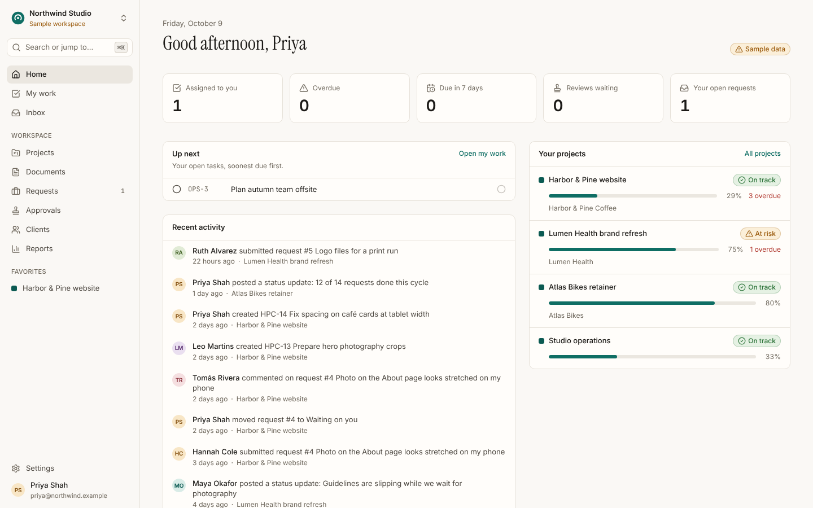

</div>

> Orqivanta is a portfolio project. The sample studio (“Northwind Studio”) and everyone in it are
> fictional, and the product labels that data wherever it appears. There are no fake charts, no
> simulated integrations and no buttons that do nothing.

## Screenshots

| | |
| --- | --- |
| 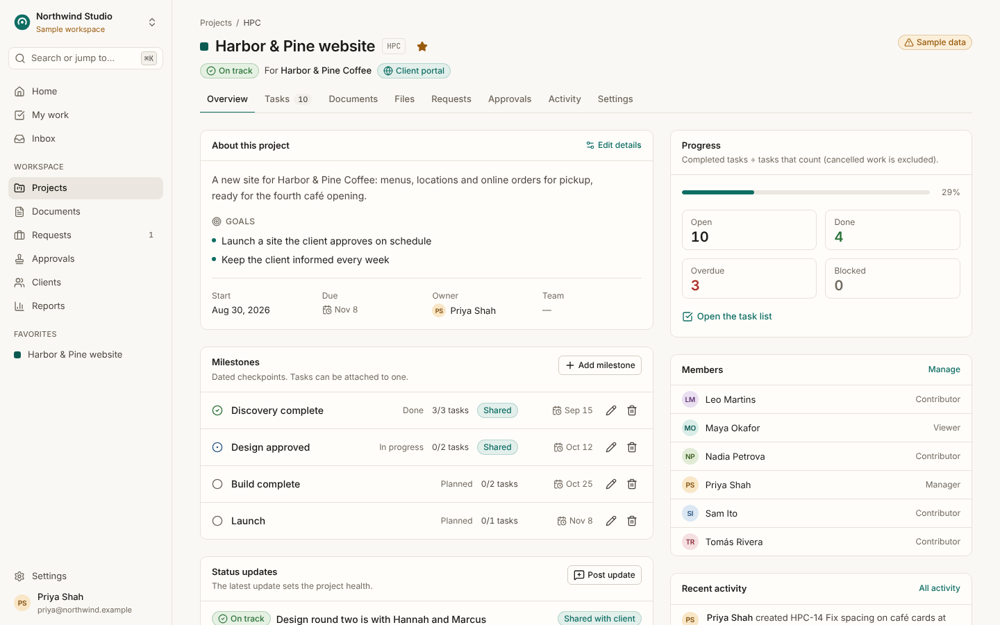 **Project overview**: goals, milestones, health updates and progress you can trace back to tasks. | 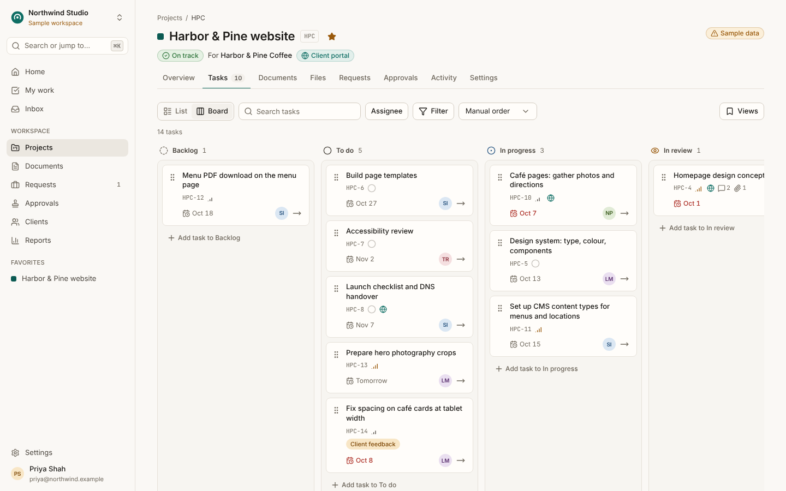 **Task board**: drag and drop with a full keyboard path, plus list view, filters and saved views. |
| 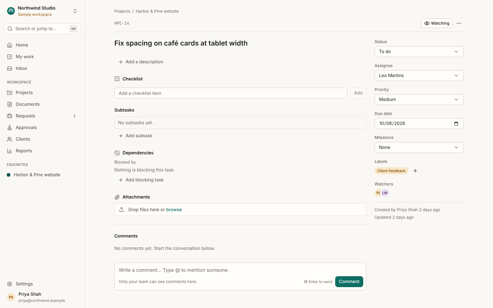 **Task detail**: subtasks, checklists, dependencies, watchers, comments and field history. | 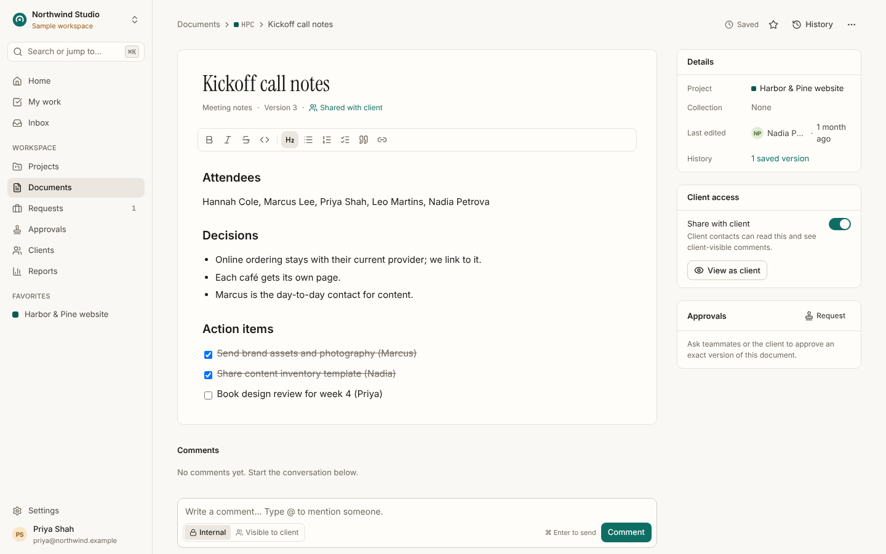 **Documents**: rich text with autosave, version history and a conflict dialog instead of silent overwrites. |
| 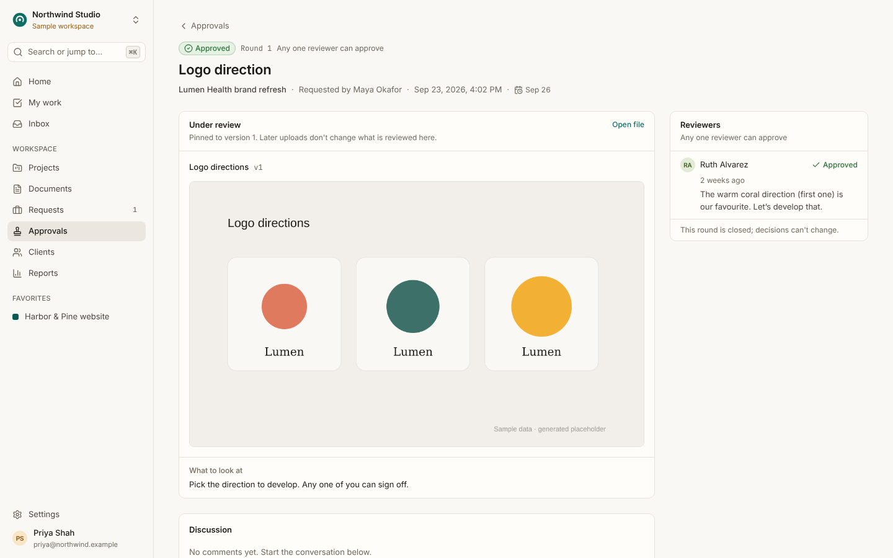 **Approvals**: pinned to an exact file or document version; a new version opens a new round. | 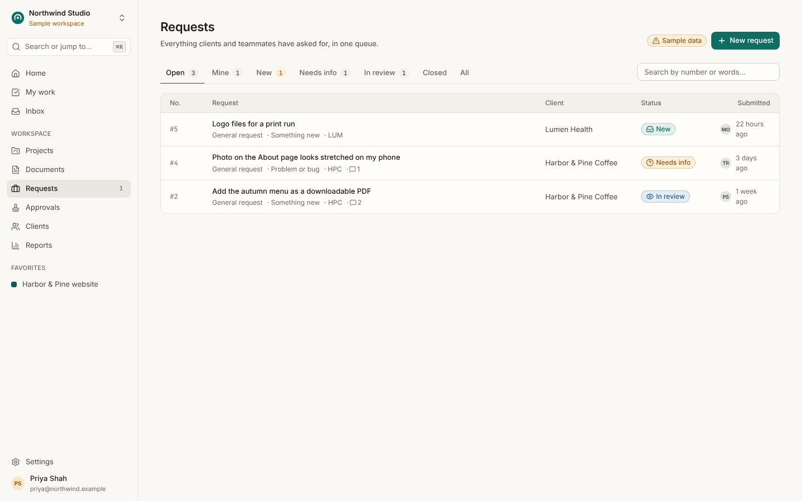 **Requests**: typed intake forms, a triage queue, clarification threads and one-click conversion to tasks. |
| 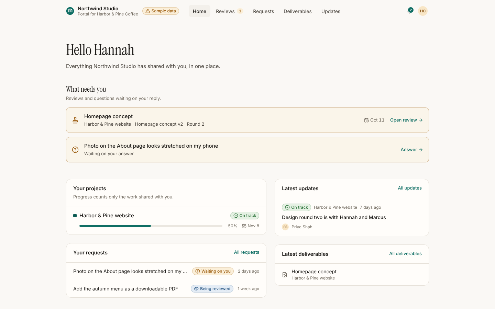 **Client portal**: clients see only what was shared with them, send requests and review work. | 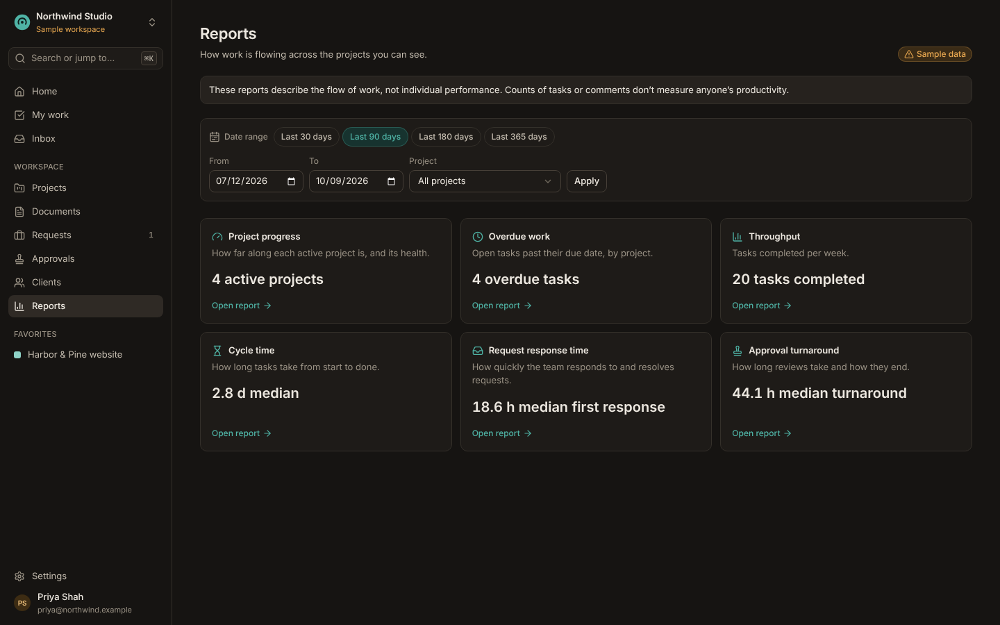 **Reports** (dark theme): six reports, each with a table, a written definition and CSV export. |
| 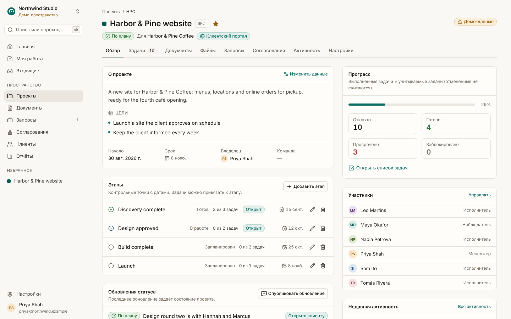 **English and Russian** throughout, including server messages and email. | 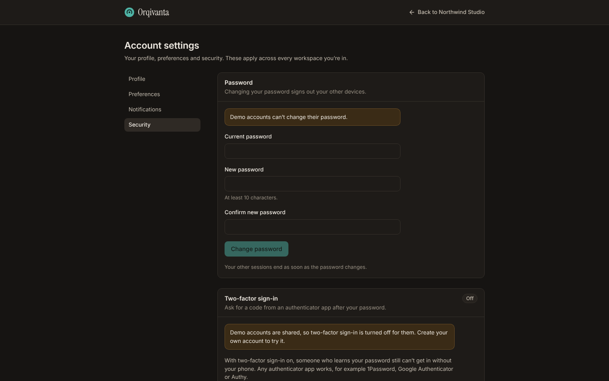 **Account security**: sessions, password changes and two-factor sign-in with recovery codes. |

<p align="center">
  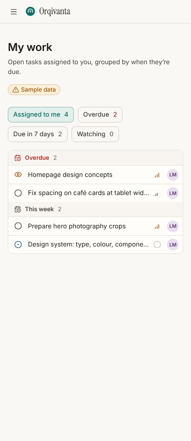
  &nbsp;&nbsp;
  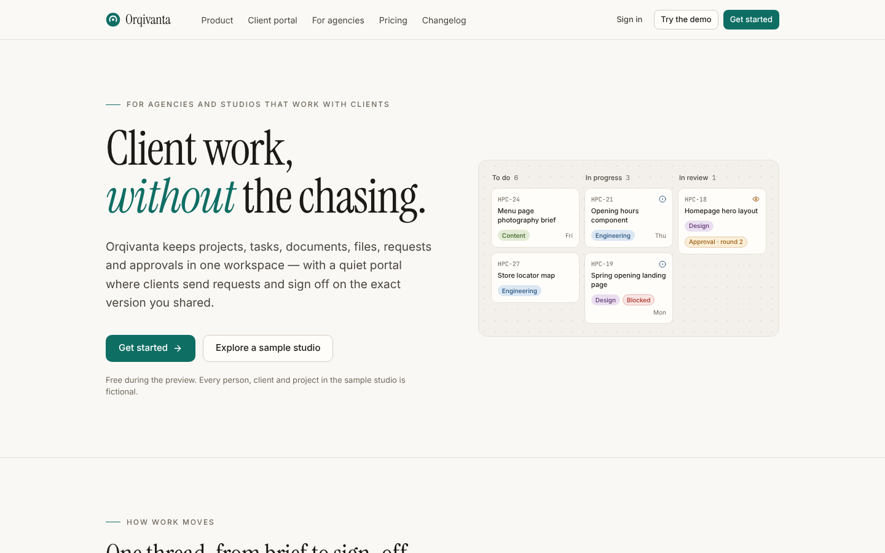
</p>

## What’s inside

| Area | Highlights |
| --- | --- |
| Projects & tasks | Goals, milestones, health updates, list and board views (with a keyboard path for drag-and-drop), subtasks, checklists, dependencies, watchers, saved views, bulk edit, field history |
| Documents | Tiptap rich text, collections, autosave with version numbers, a conflict dialog instead of silent overwrites, version history and restore |
| Files | Upload with progress, retry and cancel; versions; image and PDF previews; private storage with permission-checked downloads; real file-type detection; per-org quota |
| Requests | Typed intake forms, a triage queue, clarification threads, duplicates, convert to task or project with context kept |
| Approvals | Pinned to a file version, document version or milestone; any/all rules; new versions reopen review as a new round; reminders |
| Client portal | Requests, reviews, deliverables and updates — only items explicitly shared with that client account |
| Notifications & search | In-app inbox, email, per-category preferences, live updates over SSE, permission-aware full-text search and ⌘K palette |
| Reports | Progress, overdue work, throughput, cycle time, request response and approval turnaround — each with a table, a written definition and CSV export |
| Accounts & security | Email verification, password reset, active sessions, two-factor sign-in with an authenticator app and single-use recovery codes |
| Admin | Members, invitations, teams, clients, request forms, labels, audit log, data export, trash |
| i18n & a11y | English and Russian; light and dark themes; WCAG 2.2 AA target checked with axe |

## Stack

- **Web:** Next.js 15 (App Router, server actions), React 19, Tailwind CSS 4, Radix primitives, Tiptap, next-intl
- **Data:** PostgreSQL 16 with row-level security on every tenant table, Drizzle ORM, zod
- **Background work:** a transactional outbox drained by a small worker (`LISTEN/NOTIFY` + polling), plus scheduled reminders and cleanup
- **Live updates:** Server-Sent Events fed by `pg_notify`, with replay after a reconnect
- **Security:** argon2id passwords, hashed session and email tokens, TOTP two-factor sign-in, rate limits, strict tenant isolation enforced by the database
- **Tests:** Vitest integration tests against a real database (permissions, tenant isolation, workflows) and Playwright + axe end-to-end tests

Everything runs locally and for free: no paid services are needed.

## How it fits together

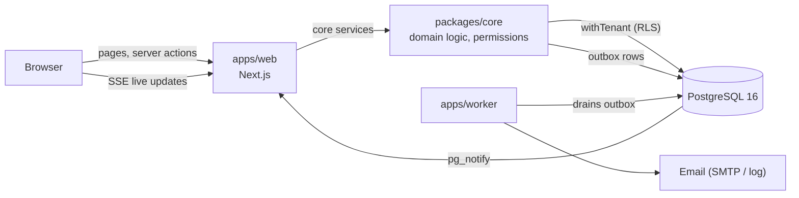

## Repository layout

```
apps/web        Next.js app: marketing site, auth, workspace, client portal, API routes
apps/worker     Outbox delivery (email, notifications), reminders and cleanup jobs
packages/core   Domain services, permissions, validation, email templates, demo seed
packages/db     Drizzle schema, SQL migrations and RLS policies
infra/postgres  Database roles for local development and CI
docs/           Architecture notes, project status and screenshots
```

## Demo accounts

Every account uses the password `orqivanta-demo`, or open `/demo` and pick a role.

| Email | Who | Role |
| --- | --- | --- |
| `maya@northwind.example` | Maya Okafor, studio director | Owner |
| `priya@northwind.example` | Priya Shah, producer | Admin |
| `leo@northwind.example` | Leo Martins, designer | Member |
| `sam@northwind.example` | Sam Ito, developer | Member |
| `nadia@northwind.example` | Nadia Petrova, content strategist | Member |
| `tomas@northwind.example` | Tomás Rivera, developer | Member |
| `hannah@harborpine.example` | Hannah Cole, Harbor & Pine | Client (portal) |
| `marcus@harborpine.example` | Marcus Lee, Harbor & Pine | Client (portal) |
| `ruth@lumenhealth.example` | Ruth Alvarez, Lumen Health | Client (portal) |

## Running it locally

Requirements: Node 22, pnpm 10, Docker (or a local PostgreSQL 16).

```bash
cp .env.example .env
docker compose up -d          # PostgreSQL + Mailpit (local email inbox on :8025)
pnpm install
pnpm db:migrate
pnpm demo:reset               # seeds the fictional Northwind Studio workspace
pnpm dev                      # web on http://localhost:3000 and the worker
```

Open <http://localhost:3000/demo> and pick a role, or sign in with any demo account
(for example `priya@northwind.example`) and the password `orqivanta-demo`.
With `DEMO_MODE=true`, every email is also visible at `/dev/mailbox`.

`pnpm dev` compiles each page the first time you open it, so first visits take a few seconds.
To click around at full speed, run `pnpm preview` instead: it builds once and serves the
production app (pages render in roughly 50 to 170 ms).

Docker publishes PostgreSQL on port **5433**, so it doesn't clash with a PostgreSQL already
installed on your machine.

### Troubleshooting

`password authentication failed for user "orqivanta_app"` usually means the app reached a
different PostgreSQL. This is common on Windows, where an installed PostgreSQL service listens on
5432. Make sure `.env` points at `127.0.0.1:5433` (copy it again from `.env.example` if it is
older), then run `docker compose up -d` again.

`queryA ETIMEOUT localhost` from the worker means `localhost` could not be resolved; use
`127.0.0.1` in `SMTP_URL` and the database URLs, as `.env.example` does.

## Tests

```bash
pnpm typecheck
pnpm test        # core integration tests (uses the orqivanta_test database)
pnpm test:e2e    # Playwright + axe, against the seeded demo workspace
```

CI runs all three on every push (`.github/workflows/ci.yml`).

## Public demo deployment

The repo ships a free-tier setup: the app on Render and PostgreSQL on Neon.

1. Create a Neon project and run `infra/postgres/init.sql` against it, so the app role exists.
2. In Render, choose **New → Blueprint** and point it at this repository. `render.yaml` creates
   the web service; fill in `DATABASE_URL` (the app role), `DATABASE_ADMIN_URL` (the owner role)
   and `APP_URL`.
3. Optional nightly reset: add the secrets `DEMO_DATABASE_URL`, `DEMO_DATABASE_ADMIN_URL` and
   `RENDER_DEPLOY_HOOK`, then set the repository variable `DEMO_RESET_ENABLED=true`.

Each start applies migrations and reseeds the demo, so a restart always comes up clean.
On the free plan the worker runs in the same instance as the web server, email goes to the
log and `/dev/mailbox`, and uploads live on temporary disk until the next reset.

## Design notes

See [`docs/ARCHITECTURE.md`](docs/ARCHITECTURE.md) for how tenancy, permissions, files,
real-time updates and background jobs fit together, and [`docs/STATUS.md`](docs/STATUS.md)
for what is in this release and what deliberately isn’t.


## Author

Built by **HoPMaLbHblu**.

- GitHub: [@HoPMaLbHblu](https://github.com/HoPMaLbHblu)
- Telegram: [@ny_da_ny_daaa](https://t.me/ny_da_ny_daaa)

## License

[MIT](LICENSE)
